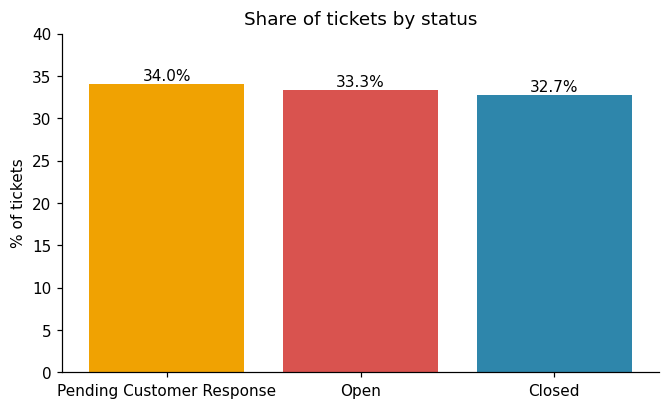
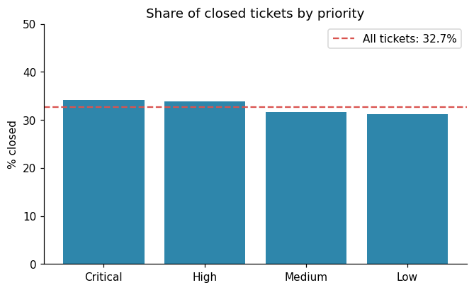
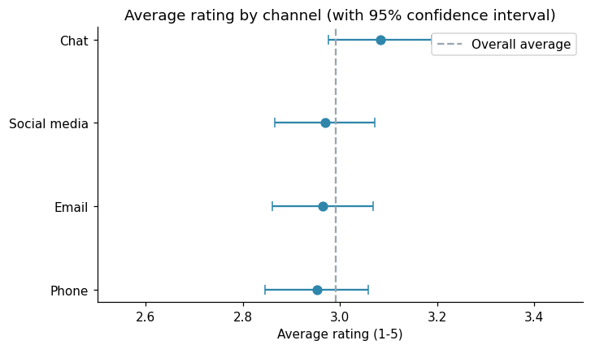
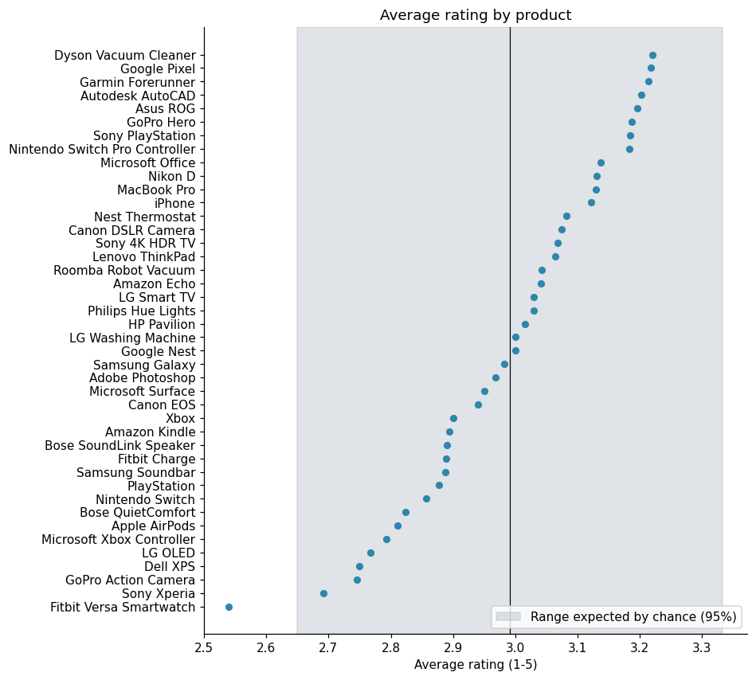

# Customer Support Tickets: SQL Analysis and Data Audit

SQL analysis of 8,469 customer support tickets: ticket volume, backlog and customer satisfaction. The project also shows how to check data quality before analysing it, and how to test whether differences between groups are real or random.

**Tools:** SQL (SQLite) as the main tool, Python (pandas, numpy, matplotlib), Jupyter Notebook

## Dataset
Customer Support Ticket Dataset from Kaggle (8,469 tickets, 17 columns). The values look generated (random text, evenly spread categories), so this is treated as a **practice dataset**: the findings describe the data, not a real company. Customer names and e-mails were removed from the copy in this repository (see `data/README.md`).

## Questions
1. Can the time columns be used to measure response and resolution time?
2. How many tickets are solved, and does priority matter?
3. How satisfied are customers, and do channels, ticket types, priorities or products differ?
4. Are the differences real or just noise?

## What I did
- **Data audit with SQL:** found that there is no ticket creation time, that for 49.3% of closed tickets the resolution time is earlier than the first response, and that every ticket text contains an unfilled placeholder. Response time and SLA were therefore **not** calculated, because the numbers would be wrong.
- **16 SQL queries:** aggregation, `CASE`, `HAVING`, CTEs and window functions (`RANK`, `SUM() OVER ()`) in `sql/queries.sql`.
- **Permutation test** (5,000 shuffles) to check whether differences in satisfaction between groups are larger than random chance.

## Key findings
- Tickets are evenly spread across 5 ticket types (19-21% each) and 4 channels (about 25% each).
- Only **32.7%** of tickets are closed; 33.3% are open and 34.0% wait for the customer. Critical tickets are closed only slightly more often (34.1%) than low-priority ones (31.2%).
- Average satisfaction of closed tickets is **2.99 / 5** (39.3% satisfied, 39.8% dissatisfied).
- Differences between channels, ticket types, priorities, age bands and products are **not larger than random** (p-values 0.30 to 0.87). The lowest-rated product looks bad on the chart but is within the range expected by chance.

## Recommendations
1. Record ticket creation time and resolution timestamps consistently, so response time and SLA can be measured.
2. Work on the backlog: two thirds of tickets are not closed, and critical tickets are not handled noticeably faster.
3. Do not act on small rating differences between channels, products or age groups.
4. Collect ratings for more tickets (ratings exist only for closed tickets).

## Charts
| | |
|---|---|
|  |  |
|  |  |

## Project structure
```
data/        customer_support_tickets.csv (names and e-mails removed)
notebooks/   support_tickets_analysis.ipynb (full analysis with outputs)
sql/         queries.sql (all SQL queries)
images/      charts used in this README
```

## How to run
```
pip install -r requirements.txt
jupyter notebook notebooks/support_tickets_analysis.ipynb
```

## Limitations
- The dataset looks synthetic, so the value of the project is the method, not the business findings.
- Closing rates by priority were compared without a significance test, and the differences are small.
